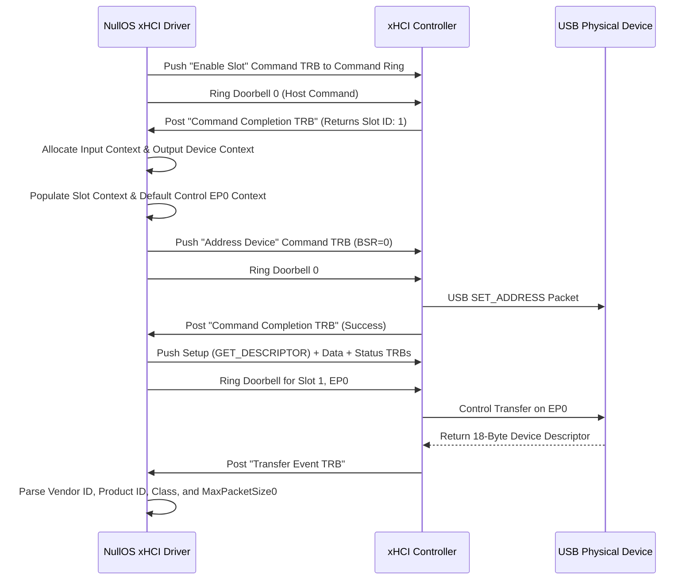

# Chapter 26: USB 3.0 xHCI Controller & HID Input Subsystems
### *Extensible Host Controller Interface (xHCI), Transfer Request Blocks (TRBs), Command & Event Rings, USB Device Enumeration, Descriptors, and USB HID Keyboard & Mouse Input*

---

## 1. Evolution of the Universal Serial Bus: From Legacy Controllers to xHCI

In earlier milestones of NullOS, user input relied on the legacy Intel 8042 PS/2 controller (`kernel/src/drivers/keyboard.rs`). While ubiquitous on older PC compatibles and emulated by QEMU, real modern silicon—ranging from contemporary laptops and server boards to UEFI platforms—lacks physical PS/2 controllers entirely. Instead, all external peripheral communication is routed through the **Universal Serial Bus (USB)**.

The host controller hardware driving USB has evolved through four major generations:

| Specification | Controller Architecture | Interface Standard | Max Data Bandwidth | Characteristics |
| :--- | :--- | :--- | :--- | :--- |
| **USB 1.1** | **UHCI** (Intel) / **OHCI** (Compaq) | Legacy Register Interface | 1.5 Mbps (Low) / 12 Mbps (Full) | Frame lists, high CPU interrupt overhead |
| **USB 2.0** | **EHCI** (Enhanced Host Controller) | High-Speed Interface | 480 Mbps (High Speed) | Requires companion UHCI/OHCI for 1.1 devices |
| **USB 3.0+** | **xHCI** (eXtensible Host Controller) | Modern Streamlined Interface | 5 Gbps (SuperSpeed) to 20+ Gbps | Single unified controller for USB 1.1, 2.0, 3.0+ |

```
┌────────────────────────────────────────────────────────────────────────┐
│               NullOS USB Subsystem Architecture (M31)                  │
├────────────────────────────────────────────────────────────────────────┤
│                                                                        │
│   ┌────────────────────────────────────────────────────────────────┐   │
│   │           Unified Input Event Queue (INPUT_QUEUE)              │   │
│   └───────────────▲────────────────────────────────▲───────────────┘   │
│                   │                                │                   │
│         ┌─────────┴─────────┐            ┌─────────┴─────────┐         │
│         │ USB Keyboard HID  │            │  USB Mouse HID    │         │
│         │ (8-Byte Boot Rpt) │            │ (3-Byte Boot Rpt) │         │
│         └─────────▲─────────┘            └─────────▲─────────┘         │
│                   │                                │                   │
│   ┌───────────────┴────────────────────────────────┴───────────────┐   │
│   │            USB Device Abstraction & Enumeration Engine         │   │
│   │     (Device, Config, Interface & Endpoint Descriptors)        │   │
│   └───────────────────────────────▲────────────────────────────────┘   │
│                                   │                                    │
│   ┌───────────────────────────────┴────────────────────────────────┐   │
│   │         xHCI Driver (Command Ring, Event Ring, DCBAA)          │   │
│   └───────────────────────────────▲────────────────────────────────┘   │
│                                   │ MMIO                               │
│   ┌───────────────────────────────┴────────────────────────────────┐   │
│   │    PCI Bus: Class 0x0C (Serial), Subclass 0x03, Prog IF 0x30   │   │
│   └────────────────────────────────────────────────────────────────┘   │
└────────────────────────────────────────────────────────────────────────┘
```

**Milestone 31** implements a native, `#![no_std]` Rust **xHCI Host Controller Driver** and **USB HID Input Subsystem**:
1. **PCI Discovery & MMIO Mapping**: Enumerates the xHCI controller on the PCI bus and identity-maps its Base Address Register (BAR0).
2. **xHCI Register Spaces**: Accesses Capability, Operational, Runtime, and Doorbell register blocks.
3. **Ring Buffer Primitives**: Implements circular Transfer Request Block (TRB) rings with Producer Cycle State (PCS) tracking.
4. **Command & Event Engines**: Manages the Host Command Ring and Event Ring Segment Table (ERST).
5. **Root Hub Port Management**: Detects port connections, issues port resets, and identifies speed classes via `PORTSC`.
6. **Device Context Base Address Array (DCBAA)**: Configures device slots, input contexts, and endpoint transfer rings.
7. **USB Standard Descriptors**: Retrieves and parses Device, Configuration, Interface, and Endpoint descriptors via Control transfers.
8. **USB HID Class Driver**: Decodes Boot Protocol reports for USB keyboards and mice, feeding events into `INPUT_QUEUE`.

---

## 2. xHCI Controller Architecture & Register Spaces

Unlike EHCI, which required complex scheduling trees and companion controllers, xHCI offloads transfer scheduling onto hardware state machines. Software communicates with the xHCI controller via **Memory-Mapped I/O (MMIO)** partitioned into four distinct register spaces:

```
BAR0 Base Physical Address (e.g. 0xFEB00000)
│
├── 0x0000: Capability Registers (Read-Only hardware limits & offsets)
│           ├── CAPLENGTH, HCIVERSION, HCSPARAMS1, HCSPARAMS2, HCCPARAMS1
│           ├── DBOFF  (Offset to Doorbell Registers)
│           └── RTSOFF (Offset to Runtime Registers)
│
├── Base + CAPLENGTH: Operational Registers (Read/Write controller controls)
│           ├── USBCMD (Run/Stop, Controller Reset, Host System Error Enable)
│           ├── USBSTS (HCHalted, Host System Error, Event Interrupt)
│           ├── CRCR   (Command Ring Control Register - 64-bit physical pointer)
│           ├── DCBAAP (Device Context Base Address Array Pointer - 64-bit pointer)
│           ├── CONFIG (Max Device Slots Enabled)
│           └── PORTSC (Port Status and Control registers for each root hub port)
│
├── Base + RTSOFF: Runtime Registers
│           └── Interrupter 0 Registers: IMAN, IMOD, ERSTSZ, ERSTBA, ERDP
│
└── Base + DBOFF: Doorbell Registers
            ├── Doorbell 0: Host Controller Command Ring Kick
            └── Doorbell 1..255: Device Slot Endpoints 0..31 Kicks
```

### 2.1 Capability Registers

The Capability Registers are fixed at the base of the MMIO region and define the hardware geometry of the controller:

```rust
#[repr(C)]
pub struct XhciCapRegs {
    pub caplength: u8,       // Operational Register Offset = Base + caplength
    pub reserved: u8,
    pub hciversion: u16,     // BCD format: 0x0100 for xHCI 1.0, 0x0110 for 1.1
    pub hcsparams1: u32,     // MaxSlots (bits 0..7), MaxIntrs (bits 8..18), MaxPorts (bits 24..31)
    pub hcsparams2: u32,     // Scratchpad buffers and max scratchpad buffers
    pub hcsparams3: u32,     // Latencies
    pub hccparams1: u32,     // 64-bit addressing (bit 0), xECP capability pointer (bits 16..31)
    pub dboff: u32,          // Doorbell array byte offset from MMIO base
    pub rtsoff: u32,         // Runtime register space byte offset from MMIO base
    pub hccparams2: u32,     // Extended capabilities
}
```

### 2.2 Operational Registers

The Operational Registers begin at `MMIO Base + caplength`:
- **USBCMD (USB Command Register)**:
  - Bit 0 (`R/S` - Run/Stop): `1` = Controller active and processing rings, `0` = Halted.
  - Bit 1 (`HCRST` - Host Controller Reset): Writing `1` resets all internal state machines.
  - Bit 2 (`INTE` - Interrupter Enable): Enables global interrupt generation.
- **USBSTS (USB Status Register)**:
  - Bit 0 (`HCH` - HC Halted): Controller is stopped when `1`.
  - Bit 3 (`EINT` - Event Interrupt): Asserted when an event is posted to the Event Ring.
- **CRCR (Command Ring Control Register)**:
  - Physical address of the 64-byte aligned Command Ring buffer.
  - Bit 0 (`RCS` - Ring Cycle State): Initial cycle bit value (must be set to `1` on initialization).
- **DCBAAP (Device Context Base Address Array Pointer)**:
  - Physical address of the array of 64-bit pointers to Device Contexts.
- **CONFIG (Configure Register)**:
  - Bits 0..7 (`MaxSlotsEn`): Maximum number of enabled device slots (1 to `MaxSlots`).

---

## 3. Transfer Request Blocks (TRBs) & Circular Ring Architecture

All communication between the operating system and the xHCI hardware occurs through memory-mapped circular queues called **Rings**. Every entry in a ring is a 16-byte structure termed a **Transfer Request Block (TRB)**:

```
 0                   1                   2                   3
 0 1 2 3 4 5 6 7 8 9 0 1 2 3 4 5 6 7 8 9 0 1 2 3 4 5 6 7 8 9 0 1
+-+-+-+-+-+-+-+-+-+-+-+-+-+-+-+-+-+-+-+-+-+-+-+-+-+-+-+-+-+-+-+-+
│                      Parameter Low (u32)                      │
+-+-+-+-+-+-+-+-+-+-+-+-+-+-+-+-+-+-+-+-+-+-+-+-+-+-+-+-+-+-+-+-+
│                      Parameter High (u32)                     │
+-+-+-+-+-+-+-+-+-+-+-+-+-+-+-+-+-+-+-+-+-+-+-+-+-+-+-+-+-+-+-+-+
│                          Status (u32)                         │
+-+-+-+-+-+-+-+-+-+-+-+-+-+-+-+-+-+-+-+-+-+-+-+-+-+-+-+-+-+-+-+-+
│C| Flags (bits 1..9) |      TRB Type (bits 10..15)     | Control│
+-+-+-+-+-+-+-+-+-+-+-+-+-+-+-+-+-+-+-+-+-+-+-+-+-+-+-+-+-+-+-+-+
```

### 3.1 The Producer Cycle State (PCS) Mechanism
Traditional hardware descriptor rings rely on Head and Tail registers updated over PCI for every item, creating high bus traffic. xHCI solves this with a **Cycle Bit (C)**:
1. When software initializes a ring, all entries have their Cycle Bit initialized to `0`.
2. Software maintains an internal `cycle_state: bool = true`.
3. When writing a new TRB, software sets its `C` bit to `cycle_state`.
4. When software wraps around the end of the ring (via a `Link TRB`), it toggles `cycle_state = !cycle_state`.
5. The hardware advances its consumer pointer as long as the TRB's Cycle Bit matches its internal expected cycle state!

### 3.2 Key TRB Types

| TRB Type ID | TRB Name | Direction | Purpose |
| :---: | :--- | :---: | :--- |
| `1` | **Normal TRB** | Host $\to$ Controller | Raw DMA data payload transfer on an endpoint |
| `2` | **Setup Stage TRB** | Host $\to$ Controller | 8-byte USB standard setup packet on Endpoint 0 |
| `3` | **Data Stage TRB** | Host $\to$ Controller | Data payload phase of a USB control transfer |
| `4` | **Status Stage TRB** | Host $\to$ Controller | Handshake completion phase of a control transfer |
| `6` | **Link TRB** | Host $\to$ Controller | Points to the first TRB of the ring to wrap around |
| `9` | **Enable Slot TRB** | Host $\to$ Controller | Commands controller to assign a new Slot ID |
| `11`| **Address Device TRB**| Host $\to$ Controller | Sets device address and initializes Endpoint 0 context |
| `12`| **Configure Endpoint**| Host $\to$ Controller | Enables interrupt/bulk transfer endpoints |
| `32`| **Transfer Event TRB**| Controller $\to$ Host | Reports completion or error of a data transfer |
| `33`| **Command Completion**| Controller $\to$ Host | Reports completion status of a Command Ring TRB |
| `34`| **Port Status Change**| Controller $\to$ Host | Fired when a USB device is plugged in or unplugged |

---

## 4. Event Ring & Event Ring Segment Table (ERST)

While software produces commands on the **Command Ring**, the xHCI controller produces events on the **Event Ring** to notify the driver of command completions, port status changes, and transfer receipts.

To support memory virtualization without requiring contiguous multi-megabyte allocations, the Event Ring is defined by an **Event Ring Segment Table (ERST)**:

```
Interrupter 0 Registers
├── ERSTSZ: Table Size = 1
├── ERSTBA: Physical Pointer to ERST Array
└── ERDP:   Event Ring Dequeue Pointer (Read/Write by software)

ERST Entry (16 bytes):
├── Base Address (64-bit): Pointer to contiguous TRB array
└── Size (32-bit):         Number of TRB entries in this segment (e.g. 64)
```

When software handles an event from the Event Ring:
1. It reads the TRB at the current dequeue index.
2. If the TRB's Cycle Bit matches software's expected Event Ring cycle bit, the event is valid.
3. Software processes the event, advances the dequeue pointer, and writes the updated address back to `ERDP`.

---

## 5. Root Hub Port Management & Device Discovery

The xHCI controller features an integrated Root Hub exposing physical downstream USB ports. Each port is controlled via a dedicated **PORTSC (Port Status and Control)** register located at `Operational Base + 0x400 + (port_index * 0x10)`:

- Bit 0 (`CCS` - Current Connect Status): `1` if a device is physically attached.
- Bit 1 (`PED` - Port Enabled/Disabled): `1` if the port is active.
- Bit 4 (`PR` - Port Reset): Writing `1` drives a USB bus reset signaling the device to wake up.
- Bits 10..13 (`Port Speed`):
  - `1`: Full-Speed (12 Mbps - USB 1.1)
  - `2`: Low-Speed (1.5 Mbps - USB 1.1)
  - `3`: High-Speed (480 Mbps - USB 2.0)
  - `4`: SuperSpeed (5 Gbps - USB 3.0)

### Port Initialization Sequence:
1. Poll `PORTSC` for `CCS == 1` (Device connected).
2. Write `PR = 1` to assert a hardware reset on the bus line.
3. Spin-wait for the hardware to clear `PR = 0` and assert `PED = 1` (Port Enabled).
4. Read the negotiated Port Speed from bits 10..13.

---

## 6. USB Device Enumeration Lifecycle

Once a port is enabled, the device enters the Default state listening on address `0`. The driver coordinates with xHCI to initialize device contexts and assign a permanent hardware slot:



---

## 7. USB Standard Descriptors

USB devices describe their capabilities through standardized hierarchical binary structures retrieved via `GET_DESCRIPTOR` control requests:

### 7.1 Standard Device Descriptor (18 Bytes)
```rust
#[repr(C, packed)]
pub struct UsbDeviceDescriptor {
    pub length: u8,             // Size of descriptor = 18 bytes (0x12)
    pub descriptor_type: u8,    // 0x01 = Device Descriptor
    pub bcd_usb: u16,           // USB Spec Release (e.g. 0x0200 = USB 2.0)
    pub device_class: u8,       // Class code (0x00 if specified at Interface level)
    pub device_subclass: u8,    // Subclass code
    pub device_protocol: u8,    // Protocol code
    pub max_packet_size0: u8,   // Max packet size for EP0 (8, 16, 32, or 64 bytes)
    pub vendor_id: u16,         // Vendor ID assigned by USB-IF
    pub product_id: u16,        // Product ID assigned by manufacturer
    pub bcd_device: u16,        // Device release number
    pub manufacturer_idx: u8,   // String descriptor index for manufacturer
    pub product_idx: u8,        // String descriptor index for product
    pub serial_number_idx: u8,  // String descriptor index for serial number
    pub num_configurations: u8, // Number of possible configurations (typically 1)
}
```

### 7.2 Configuration, Interface & Endpoint Hierarchy
- **Configuration Descriptor (9 bytes)**: Specifies total power requirements and interface count.
- **Interface Descriptor (9 bytes)**: Groups endpoints. For USB HID, `interface_class = 0x03`, `interface_subclass = 0x01` (Boot Interface), and `interface_protocol = 0x01` (Keyboard) or `0x02` (Mouse).
- **Endpoint Descriptor (7 bytes)**: Specifies endpoint address (e.g., `0x81` = Endpoint 1 IN), transfer type (`0x03` = Interrupt), max packet size, and polling interval.

---

## 8. USB HID Input Subsystem: Keyboards & Mice

The **Human Interface Device (HID)** specification defines how user input peripherals stream human interactions to the host. To support pre-boot firmware without requiring full report descriptor parsers, USB HID specifies standard **Boot Protocol Reports**:

### 8.1 USB Boot Keyboard Report (8 Bytes)
```
Byte 0: Modifier Keys Bitmask
        Bit 0: Left Ctrl       Bit 4: Right Ctrl
        Bit 1: Left Shift      Bit 5: Right Shift
        Bit 2: Left Alt        Bit 6: Right Alt
        Bit 3: Left GUI (Meta) Bit 7: Right GUI (Meta)
Byte 1: Reserved (0x00)
Bytes 2..7: Up to 6 simultaneous Key Usage IDs (N-Key Rollover)
```
When a key is pressed, its USB HID Key Usage ID (e.g., `0x04` = 'A', `0x28` = Enter, `0x29` = Escape) is placed into bytes 2..7. When released, the byte returns to `0x00`.

### 8.2 USB Boot Mouse Report (3 or 4 Bytes)
```
Byte 0: Button Bitmask
        Bit 0: Left Button
        Bit 1: Right Button
        Bit 2: Middle Button
Byte 1: Signed 8-bit X Displacement delta (dx)
Byte 2: Signed 8-bit Y Displacement delta (dy)
Byte 3: Optional signed scroll wheel delta (dz)
```

The NullOS HID driver decodes these report packets and converts them directly into `InputEvent::Key`, `InputEvent::MouseMove`, `InputEvent::MouseDown`, and `InputEvent::MouseUp`, pushing them into the global thread-safe `INPUT_QUEUE`.

---

## 9. Interactive Shell Diagnostics (`lsusb` / `usb`)

Milestone 31 integrates the `usb` and `lsusb` commands into the NullOS interactive shell (`nsh`), allowing operators to inspect host controllers, root hub ports, and connected peripherals directly:

```
nullos> usb
xHCI Host Controller (PCI 00:04.0):
  Hardware Version:    xHCI 1.0 (BCD: 0x0100)
  Max Device Slots:    64
  Max Root Hub Ports:  4
  Operational State:   Active (Run/Stop = 1)
  Command Ring:        Active at 0x1d400000

Connected USB Devices:
--------------------------------------------------------------------------------
PORT   SPEED       SLOT   VENDOR:DEVICE   CLASS           DESCRIPTION
--------------------------------------------------------------------------------
Port 1 SuperSpeed  1      1AF4:1005       03:01 (HID)     QEMU USB Keyboard
Port 2 HighSpeed   2      1AF4:1006       03:01 (HID)     QEMU USB Tablet / Mouse
Port 3 Disconnected -     ----:----       --:--           Empty
Port 4 Disconnected -     ----:----       --:--           Empty
--------------------------------------------------------------------------------
```

---

## 10. Summary & Milestone Checklist

| Subsystem Component | Status | Architectural Role |
| :--- | :---: | :--- |
| **PCI xHCI Discovery** | ✅ Planned | Probes PCI configuration space for Class `0x0C`, Subclass `0x03`, Prog IF `0x30` |
| **MMIO Identity Mapping** | ✅ Planned | Identity-maps controller Base Address Register (BAR0) with cache disable |
| **Ring Primitives** | ✅ Planned | 16-byte TRB circular ring buffers with Producer Cycle State (PCS) tracking |
| **Command Ring Engine** | ✅ Planned | Issues Host Controller commands (Enable Slot, Address Device, Evaluate Context) |
| **Event Ring & ERST** | ✅ Planned | Processes controller completions and interrupt events |
| **Root Hub Management**| ✅ Planned | Monitors `PORTSC` registers and issues bus resets |
| **Device Enumeration** | ✅ Planned | Manages DCBAA slots, input contexts, and Endpoint 0 control transfers |
| **USB Descriptors** | ✅ Planned | Parses 18-byte Device Descriptors and Interface/Endpoint hierarchies |
| **USB Keyboard HID** | ✅ Planned | Translates 8-byte Boot Reports into unified key events |
| **USB Mouse HID** | ✅ Planned | Translates 3-byte Boot Reports into cursor coordinates in `INPUT_QUEUE` |
| **Shell Command** | ✅ Planned | `usb` / `lsusb` diagnostics and automated Test Phase 23 |

